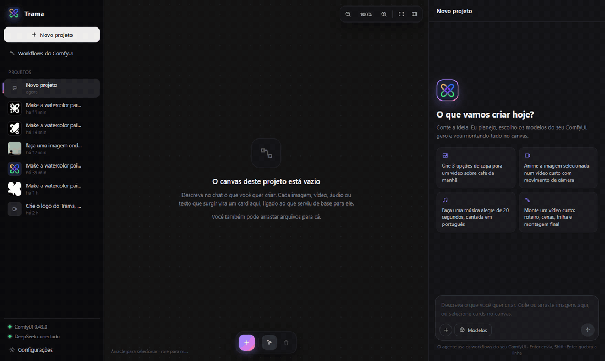
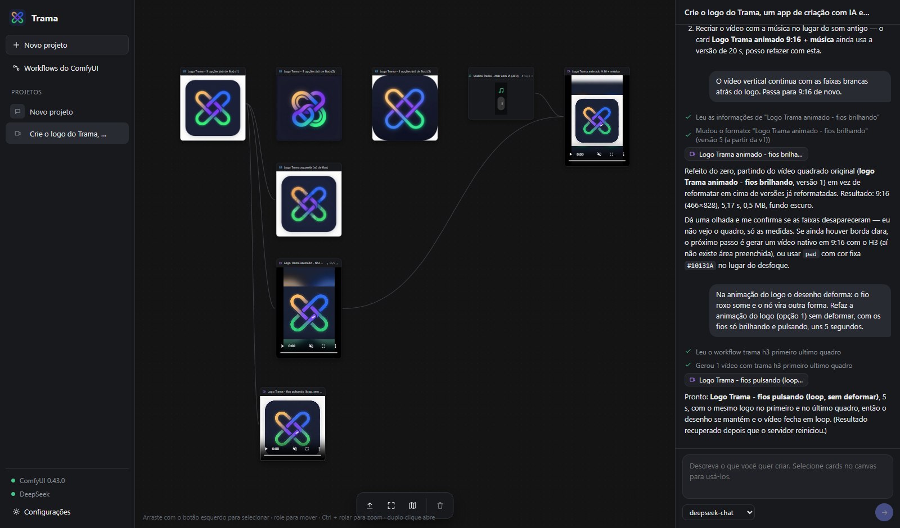
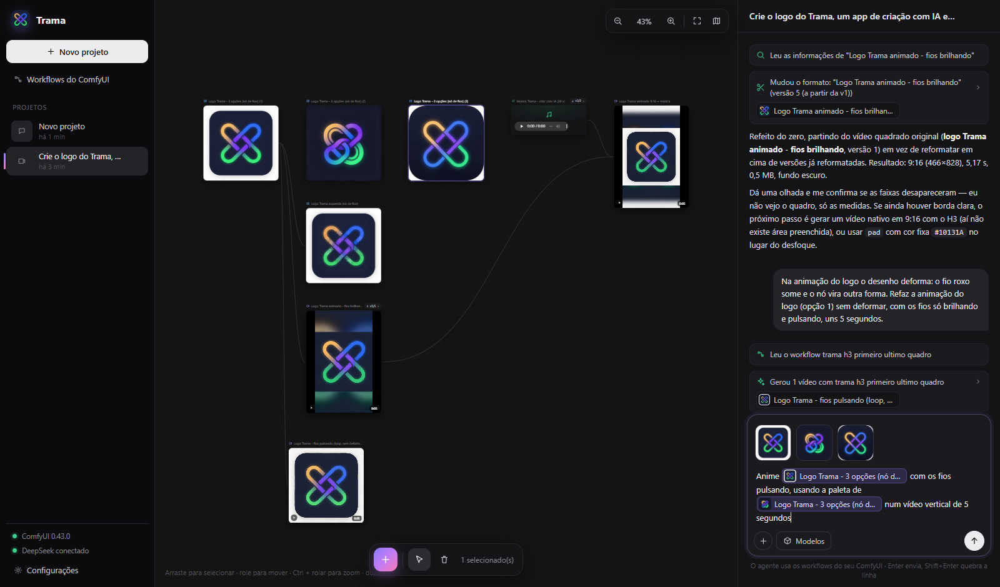
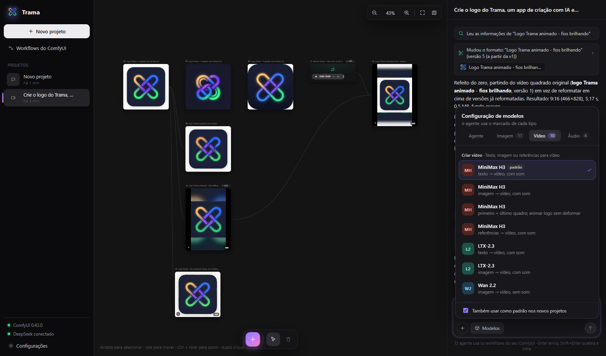
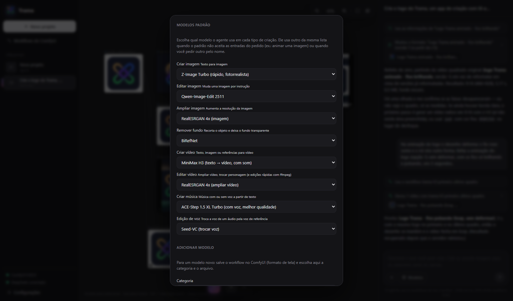
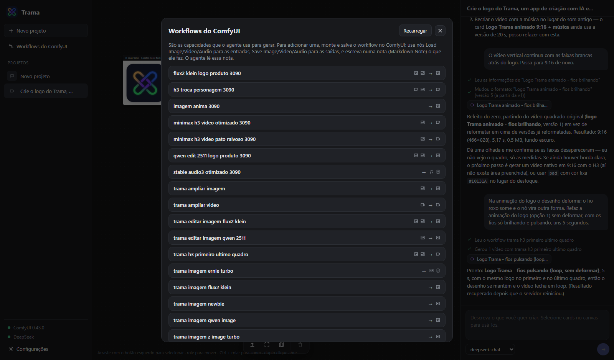

<p align="center">
  
</p>

<h1 align="center">Trama</h1>

<p align="center">
  <b>A multi-orchestrator for ComfyUI.</b><br/>
  Chat with an AI agent that plans the work, picks the right ComfyUI workflow for each step,
  runs it on your own GPU and builds the whole creative flow on a canvas.
</p>

<p align="center">
  
</p>

---

## What it is

Trama turns your local [ComfyUI](https://github.com/comfyanonymous/ComfyUI) into a conversational creative studio.

You describe what you want ("make a 10-second vertical video of my logo with a happy song in Portuguese"). The agent:

1. understands the request and asks short questions only when a decision is really yours (with clickable options);
2. chooses, for every step, the right **capability** (create image, edit image, create video, create music, change voice…) and the **default model** you configured for it;
3. runs the matching ComfyUI workflow, measures the real result (duration, resolution, silence, borders…) and fixes what it can;
4. places every result on a **canvas** as a card linked to the cards it was made from, so the flow of the project stays visible.

Everything runs locally: the agent talks to an LLM (DeepSeek, OpenAI-compatible API) and every image, video and audio is generated by **your** ComfyUI.

> The interface is currently in Brazilian Portuguese. The agent answers in the language you write to it.

## Features

- **Projects → canvas → chat** layout. Each project keeps its own conversation and canvas.
- **Organized sidebar**: right-click a project to rename it, archive it, or move it into a folder (or create a new folder on the spot). Projects can also be dragged into folders. Archived projects sit in a collapsible group at the end.
- **MCP server for outside agents**: Claude Code, Codex, Cursor or any MCP client can use Trama as its studio at `http://127.0.0.1:5190/mcp` (Streamable HTTP). It creates projects, runs the workflows (concept art, sprites, music, voices, video, 3D), asks the built-in agent for open-ended requests and copies the finished files into its own project (`export_assets`). Long generations return a `job_id` to follow with `wait_job`. Everything shows up live on the canvas, with a "Via MCP" message in the chat. Settings shows the ready-to-paste commands.
- **Pick the AI behind the agent**: DeepSeek, OpenAI, Anthropic (Claude, through the official SDK), OpenRouter, a local text model running in ComfyUI (`trama_texto_ia_local`, tools through a JSON protocol) or any OpenAI-compatible server (LM Studio, Ollama, vLLM). Each provider keeps its own key, model and address, so switching never loses the others. Switch from the button at the top of the chat or in Settings.
- **Rich composer**: paste images straight from the clipboard (video links become tags with the video title), drag files in, or select cards on the canvas. Click an attached thumbnail to cite it *inside* your sentence ("animate [logo] using the palette of [poster]"), so the agent knows exactly which input is which.
- **Model picker in the chat**: switch the model of any capability (image, video, audio) for the current project, and optionally make it the default for new projects.
- **Agent with tools**: discover and read workflows, run them, revise a result with different parameters, edit media, look at images and videos with a local vision model (a video is read from its first, middle and last frames, with visible defects listed), write scripts/lyrics/plans as text cards, ask the user. The workflow catalog tells the agent how many reference pictures each workflow takes, and a dropped connection to the LLM is retried instead of ending the reply.
- **Capabilities with default models** (Settings → Default models). Each category has a short list of models, each one bound to a ready-made ComfyUI workflow. You can add your own workflows to any category.
- **Card menu**: right-click a card to open it, download the file, show it in its folder (when ComfyUI runs on the same PC) or remove it. Delete removes the selected cards and Ctrl+Z brings them back.
- **Versions**: changing something ("make it vertical", "make the song 30 s") creates a new version of the same card. Switch versions with ‹ v2/3 › on the card.
- **Cast of characters**: register each recurring character from its picture. The vision model writes a locked physical sheet: height and proportions, build, face, ears, hair, facial hair, glasses, outfit and props. Every generation that features a cast member attaches its picture as a reference and writes the sheet into the prompt, so characters keep the same body and look from scene to scene. Reference workflows can take more pictures than they expose: MiniMax H3 takes up to 9 references.
- **Character swap in video**: send a video and a photo and say "swap this character for that one". The agent looks at six frames to list who is in the video and asks which person to replace when it is not obvious. You can also point at who leaves with a picture (a screenshot or a crop from the video): the vision model suggests which person it is and the agent confirms with one click before swapping, because that comparison is not reliable on its own. Then it runs `trama_trocar_personagem_video.json` (MiniMax H3 with a character-swap LoRA). Long videos are cut into blocks of up to 10 s at 24 fps, and every block uses the same photo, prompt and seed so the new character stays the same. The original sound is laid back on top. The prompt names the other people so they are kept, and afterwards the people are counted to catch anyone who went missing. Expect about 17 to 40 minutes per block on an RTX 3090.
- **3D models from an image**: send a picture of an object or character (or ask the agent to draw one first) and get a textured 3D model (GLB) on the canvas, turning by itself. Open it to orbit and zoom. TRELLIS.2 and Pixal3D run locally from the official ComfyUI template; on an RTX 3090 a model takes about 10 minutes.
- **Point at what to fix on a 3D model**: in the open model, click **Apontar correção**, click the spot ("the hat brim is bent") and send. Trama captures that view with the spot circled in red and hands it to the agent, which fixes the source image with an image editor and rebuilds the model as a new version of the same card. These models have no text prompt, so the image is what steers them.
- **Export 3D**: GLB with texture (Blender, game engines, web), STL for 3D printing (rotated to Z-up, standing on the bed, centered and scaled to the height you choose in mm) and OBJ (mesh only). The conversion runs in Trama itself, with no extra software.
- **Swap the singing voice of a song**: send a finished song and a short clip of another voice. Mel-Band RoFormer splits vocals from the instrumental, Seed-VC re-sings the vocals in the new voice (singing mode keeps the melody), the new vocals are leveled to the original vocals and mixed back at the original length with a soft limiter, so the song keeps its loudness. When the voices are far apart the agent shifts a whole octave (±12) so the vocals stay in tune. The full 3:39 "Me Encontra" takes about 2 minutes on an RTX 3090.
- **Change a line of a song** (prototype): "swap 'me encontra, ou deixa eu te encontrar' for 'me chama, ou deixa eu te chamar'". `trama_editar_trecho_musica` re-sings only that time window with ACE-Step 1.5 (a repaint: the model gets the original song as context, with the window silenced and a mask over it, and regenerates the window with the full new lyrics). Only the new window is pasted back into the original audio, aligned, level-matched and crossfaded, so the rest of the song is the original audio untouched. The agent finds where the line is sung by transcribing the separated vocals with Whisper (with start and end of each phrase and of each word, so the window starts and ends exactly between words) and reads the tempo and key. It asks you to confirm which occurrence to change, the lyrics are built by Trama with only that occurrence replaced (with the new line in every repetition the model copies the old chorus), and after generating it transcribes the result to check that the new line was sung, trying again when it was not. The voice in the window is generated by ACE-Step from the surrounding song and may not match the singer exactly; if it changes, run the voice swap on that window to bring the original voice back.
- **The agent listens to audio** (`analyze_audio`): duration, loudness, voice only or voice with music, the voice's pitch (Hz, note, low/mid/high) and whether it is sung or spoken. It measures instead of asking you technical questions, and compares two voices to pick the octave for a voice swap.
- **Video links** (`import_link`): paste a YouTube (or Instagram, TikTok, Vimeo…) link and say what you want ("take my video and swap this character for that one"). The agent reads the link first (title, channel, duration, chapters, track and artist when the site gives them), then downloads only what the request needs: the video, just the audio, or just a section. The download becomes a card like any other. It uses [yt-dlp](https://github.com/yt-dlp/yt-dlp), which Trama fetches from its official releases the first time, and ffmpeg from PATH (without ffmpeg it falls back to a single-file format up to 720p and cannot cut sections). Use it with your own videos or ones you have the right to use.
- **Recipes**: every card remembers the workflow, values and inputs that made it, so the agent can redo only what changed.
- **Review of every generation** (Settings → "Conferir cada imagem e vídeo gerado", on by default): the local vision model describes the image or video that came out and DeepSeek compares it with what was asked. Serious problems (a character drawn twice or missing, extra people, vertical instead of horizontal, deformed faces) make the agent redo it, at most twice; small differences (pose, props, text) are only mentioned. It takes about 1 to 2 minutes per generation.
- **Automatic checks** after every generation and edit: real duration, resolution, file size, where the sound starts/ends, uniform borders, dominant color. Problems show up as warnings the agent must handle.
- **Instant local edits with ffmpeg** (no GPU): resize, change aspect ratio (crop, pad with the dominant color or blurred background), compress to a target size, trim, trim silence, crop borders, fps, speed, fade, volume, mute, loop, convert (mp4, webm, gif, mp3, wav, png, jpg), concatenate videos, add or mix audio.
- **Workflow converter**: reads workflows exactly as you save them in the ComfyUI interface (subgraphs, bypassed/muted nodes, reroutes, primitives, dynamic combos) and converts them to the API format. It is tested against the official ComfyUI frontend conversion.

<p align="center">
  
</p>

<p align="center">
  
  
</p>

## Capabilities and models

Built-in list (all workflows are created from the official ComfyUI templates and adapted to commonly available model files). Pick the default for each category in **Settings → Default models**.

| Capability | Models |
|---|---|
| Create image | Z-Image Turbo · Qwen-Image · Flux.2 Klein 4B · ERNIE Image Turbo · NewBie (anime) · Anima |
| Edit image | Qwen-Image-Edit 2511 · Flux.2 Klein 4B edit · Z-Image Turbo img2img |
| Upscale image | RealESRGAN 4x |
| Remove background | BiRefNet |
| Create video | MiniMax H3 (text, image, first + last frame, references — with audio) · LTX-2.3 (text, image — with audio) · Wan 2.2 14B (image, first + last frame) |
| Edit video | RealESRGAN 4x video upscale · MiniMax H3 character swap · ffmpeg edits |
| Create music | ACE-Step 1.5 XL Turbo (vocals + lyrics) · ACE-Step 1.5 Turbo AIO · Stable Audio 3 (instrumental / SFX) |
| Voice editing | Seed-VC (convert a speech/singing audio to a reference voice) · Seed-VC + Mel-Band RoFormer (swap the singing voice of a full song) |
| Create 3D model | TRELLIS.2 · Pixal3D (image → textured GLB) |

<p align="center">
  
  
</p>

To add a model: build and save the workflow in ComfyUI, then **Settings → Add model** (category + workflow + name). To help the agent use it well, use `Load Image/Video/Audio` nodes for inputs, `Save Image/Video/Audio` for outputs, give those nodes clear titles and write a **Markdown Note** explaining what the workflow does and what kind of prompt works — the agent reads it.


## Requirements

- Windows 10/11 (the server itself is cross-platform Node.js; the `.bat` helpers and installer are Windows-only).
- [Node.js](https://nodejs.org) 22.12+ (LTS).
- [ComfyUI](https://github.com/comfyanonymous/ComfyUI) running locally (default `http://127.0.0.1:8188`) with the model files used by the workflows you want.
- [ffmpeg](https://ffmpeg.org) on the `PATH` (for media edits and checks).
- A [DeepSeek API key](https://platform.deepseek.com) (or any OpenAI-compatible endpoint configured in Settings).
- Optional: the [ComfyUI_Seed-VC](https://github.com/billwuhao/ComfyUI_Seed-VC) custom node for voice editing. With recent PyTorch/`huggingface_hub` versions it needs two small compatibility fixes, available in [`docs/patches/comfyui_seed_vc.patch`](docs/patches/comfyui_seed_vc.patch) (`git apply` it inside the node folder).

## Getting started

The easiest way on Windows: download `Trama-Setup-<version>.exe` from the [latest release](https://github.com/lucasnumaboa/trama/releases/latest) and run it. To run from source:

```bat
git clone https://github.com/lucasnumaboa/trama.git
cd trama
start-trama.bat
```

`start-trama.bat` installs the dependencies on first run, builds the interface and opens http://127.0.0.1:5190. On the first start, open **Settings**, paste your DeepSeek key and check the ComfyUI address.

From a terminal instead:

```bash
npm install
npm start          # builds the interface and starts the server on http://127.0.0.1:5190
npm run dev        # development with hot reload on http://127.0.0.1:5191
npm test           # converter tests against the official ComfyUI conversion
```

### Installing the workflows into ComfyUI

The `trama_*.json` workflows live in your ComfyUI user folder (`ComfyUI/user/default/workflows`). This repository ships them in `server/fixtures/workflows/` — copy them there, or regenerate them from the official templates:

```bash
python tools/build_workflows.py "<ComfyUI python>/Lib/site-packages/comfyui_workflow_templates_json/templates"
```

Then check that every model in the list is usable on your machine:

```bash
node tools/test_workflows.mjs --validate   # ComfyUI accepts every workflow (nothing is generated)
node tools/test_workflows.mjs              # also runs the fast ones for real
```

### Trama's own ComfyUI nodes

Copy `comfy-nodes/ComfyUI-Trama` into `ComfyUI/custom_nodes` and restart ComfyUI. It adds **Igualar volume**, **Juntar áudios** (used by `trama_trocar_voz_musica`), **Analisar áudio** and **Transcrever voz** (used by `analyze_audio`, the transcription uses the Whisper small that comes with the Seed-VC models) and **Trecho para regerar**, **Repaint do ACE-Step 1.5** and **Colar trecho na música** (used by `trama_editar_trecho_musica`). It is plain Python with no extra packages (librosa ships with ComfyUI portable).

### Building the installer

`build-installer.bat` (or `npm run dist`) builds a Windows installer, `installer/output/Trama-Setup-<version>.exe`, with Electron and electron-builder. Run the exe to install Trama for the current user. It adds Start menu and desktop shortcuts and opens Trama in its own window, with no browser or console window. Closing the window keeps Trama running in the system tray, so generations keep going. Click the tray icon to open it again, or right-click it and choose Sair to quit.

**Updates:** the installed app checks the [GitHub releases](https://github.com/lucasnumaboa/trama/releases) when it opens and every 4 hours. When there is a newer version it asks before downloading, then offers to restart and install, or to install when you quit. You can also check from the tray menu (Procurar atualizações). To publish a new version, raise `version` in `package.json`, commit and push, then run `npm run release`. This builds the installer and creates the `v<version>` release with the exe, its `.blockmap` and `latest.yml`, which the app reads to find updates. It needs the [GitHub CLI](https://cli.github.com) logged in.

The installed app bundles its own runtime, so Node.js is not needed on that machine. ComfyUI must be running, and ffmpeg must be on the PATH for video and audio tools. Settings, the API key and projects are stored in `%APPDATA%\Trama\data`, never inside the installer, and uninstalling keeps them. The app uses port 5190, or the next free port if 5190 is taken. `npm run app` opens the same desktop window without installing.

## How it works

```
 Browser (React + React Flow)            DeepSeek (OpenAI-compatible API)
   projects · canvas · chat                     ▲  tool calls
            │ HTTP + SSE                         │
            ▼                                    │
 Trama server (Node.js / Express) ───────────────┘
   agent loop · tools · projects (JSON) · capabilities · ffmpeg edits
            │ /prompt · /history · /ws · /view · /upload
            ▼
 ComfyUI (your GPU) — workflows saved in the ComfyUI interface
```

| File | Role |
|---|---|
| `server/agent.js` | Agent loop: system prompt (capabilities, catalog, rules), tool calls, chat steps, history |
| `server/tools.js` | Agent tools: run/revise workflows, edit media, checks, versions, text cards |
| `server/capabilities.js` | Categories, model lists and defaults (`data/capabilities.json`) |
| `server/convert.js` | ComfyUI UI workflow → API prompt (subgraphs, bypass, primitives, dynamic combos) |
| `server/describe.js` | What in a workflow is a field, a media input and an output |
| `server/exec.js` | Builds and runs a workflow with values and media inputs |
| `server/media.js` | ffmpeg edits and media analysis (silence, borders, dominant color) |
| `server/projects.js` | Projects, cards, links and versions (`data/projects/`) |
| `src/` | Interface (React + React Flow) |
| `tools/` | Workflow builder, workflow tests, screenshot script |

Generated files stay in ComfyUI's own `output` and `input` folders; Trama only stores references to them. Settings (including the API key) are stored in `data/settings.json`, which is never committed or packaged.

## License

[MIT](LICENSE). The workflows are built from the official ComfyUI templates; each model keeps its own license (check them before commercial use).
