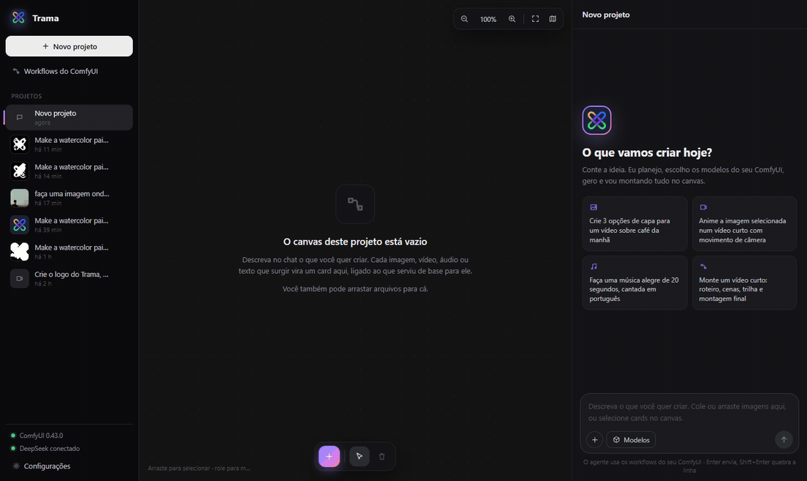
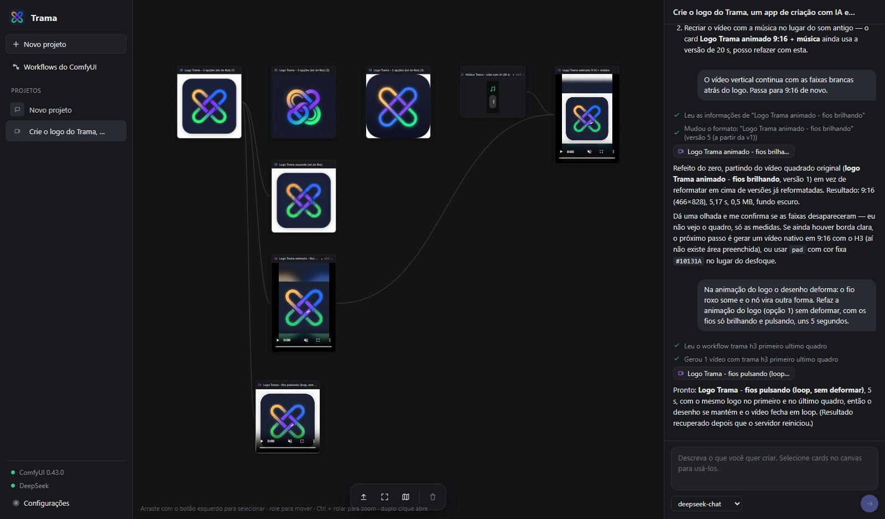
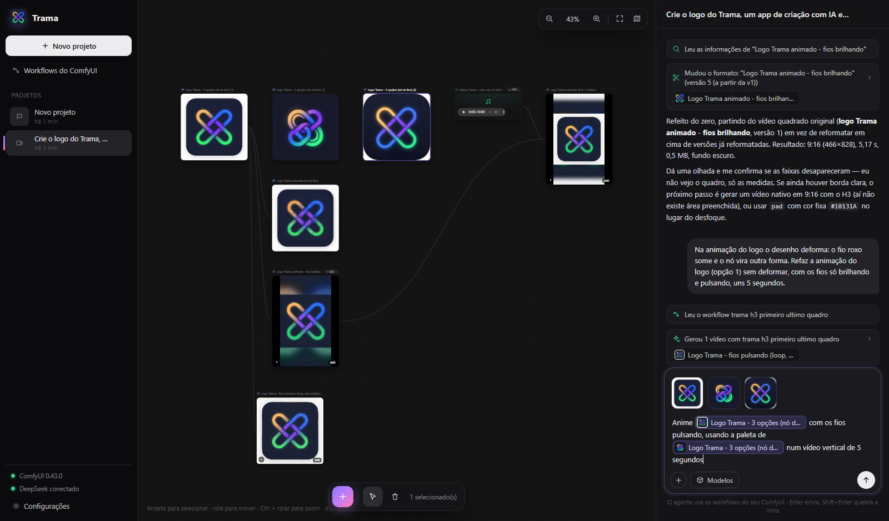
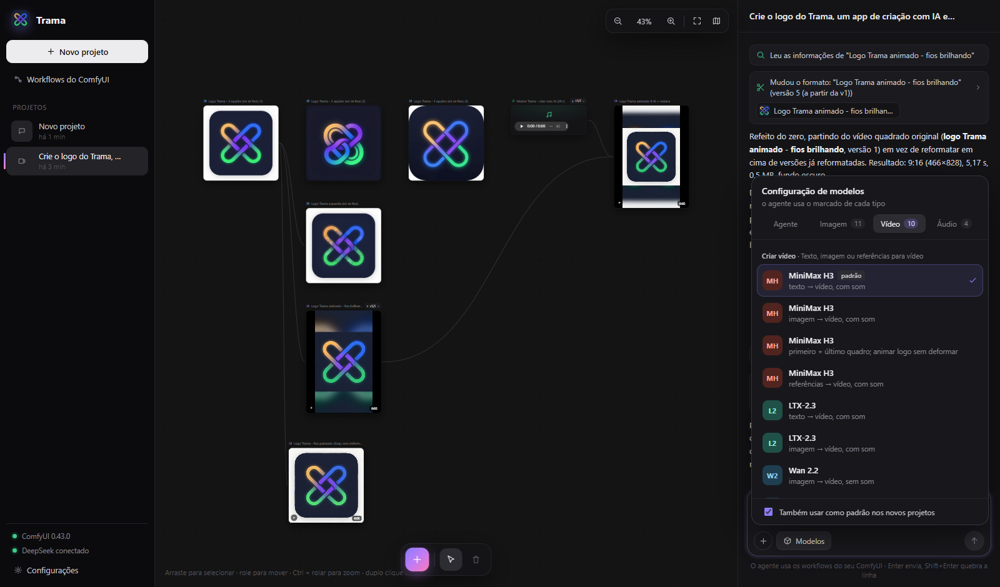
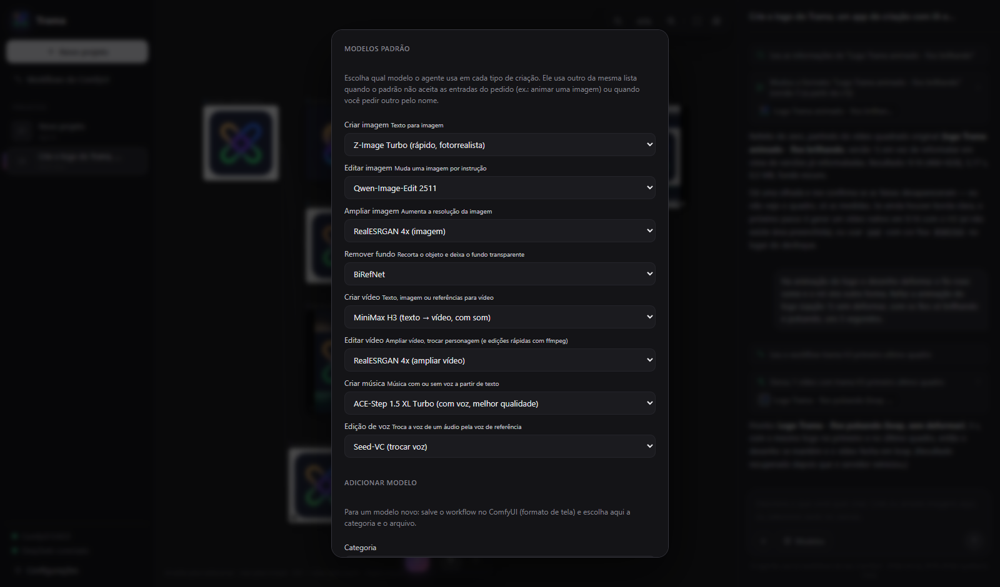
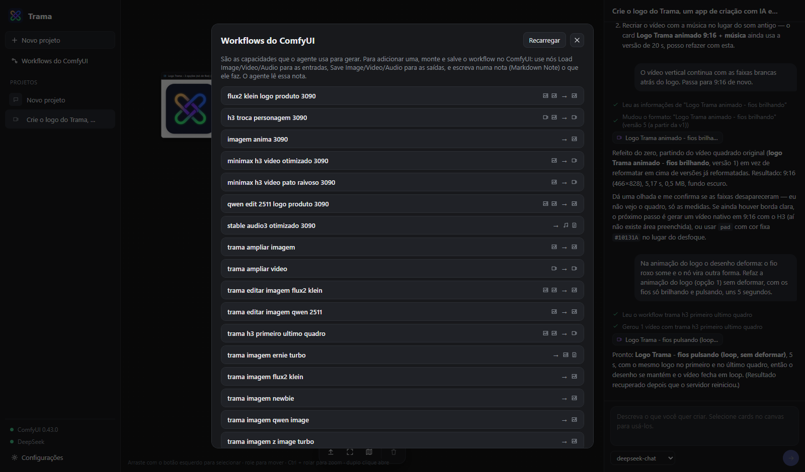

<p align="center">
  
</p>

<h1 align="center">Trama</h1>

<p align="center">
  <b>A multi-orchestrator for ComfyUI.</b><br/>
  Chat with an AI agent that plans the work, picks the right ComfyUI workflow for each step,
  runs it on your own GPU and builds the whole creative flow on a canvas.
</p>

<p align="center">
  
</p>

---

## What it is

Trama turns your local [ComfyUI](https://github.com/comfyanonymous/ComfyUI) into a conversational creative studio.

You describe what you want ("make a 10-second vertical video of my logo with a happy song in Portuguese"). The agent:

1. understands the request and asks short questions only when a decision is really yours (with clickable options);
2. chooses, for every step, the right **capability** (create image, edit image, create video, create music, change voice…) and the **default model** you configured for it;
3. runs the matching ComfyUI workflow, measures the real result (duration, resolution, silence, borders…) and fixes what it can;
4. places every result on a **canvas** as a card linked to the cards it was made from, so the flow of the project stays visible.

Everything runs locally: the agent talks to an LLM (DeepSeek, OpenAI-compatible API) and every image, video and audio is generated by **your** ComfyUI.

> The interface is currently in Brazilian Portuguese. The agent answers in the language you write to it.

## Features

- **Projects → canvas → chat** layout. Each project keeps its own conversation and canvas.
- **Rich composer**: paste images straight from the clipboard, drag files in, or select cards on the canvas. Click an attached thumbnail to cite it *inside* your sentence ("animate [logo] using the palette of [poster]"), so the agent knows exactly which input is which.
- **Model picker in the chat**: switch the model of any capability (image, video, audio) for the current project, and optionally make it the default for new projects.
- **Agent with tools**: discover and read workflows, run them, revise a result with different parameters, edit media, write scripts/lyrics/plans as text cards, ask the user.
- **Capabilities with default models** (Settings → Default models). Each category has a short list of models, each one bound to a ready-made ComfyUI workflow. You can add your own workflows to any category.
- **Versions**: changing something ("make it vertical", "make the song 30 s") creates a new version of the same card. Switch versions with ‹ v2/3 › on the card.
- **Recipes**: every card remembers the workflow, values and inputs that made it, so the agent can redo only what changed.
- **Automatic checks** after every generation and edit: real duration, resolution, file size, where the sound starts/ends, uniform borders, dominant color. Problems show up as warnings the agent must handle.
- **Instant local edits with ffmpeg** (no GPU): resize, change aspect ratio (crop, pad with the dominant color or blurred background), compress to a target size, trim, trim silence, crop borders, fps, speed, fade, volume, mute, loop, convert (mp4, webm, gif, mp3, wav, png, jpg), concatenate videos, add or mix audio.
- **Workflow converter**: reads workflows exactly as you save them in the ComfyUI interface (subgraphs, bypassed/muted nodes, reroutes, primitives, dynamic combos) and converts them to the API format. It is tested against the official ComfyUI frontend conversion.

<p align="center">
  
</p>

<p align="center">
  
  
</p>

## Capabilities and models

Built-in list (all workflows are created from the official ComfyUI templates and adapted to commonly available model files). Pick the default for each category in **Settings → Default models**.

| Capability | Models |
|---|---|
| Create image | Z-Image Turbo · Qwen-Image · Flux.2 Klein 4B · ERNIE Image Turbo · NewBie (anime) · Anima |
| Edit image | Qwen-Image-Edit 2511 · Flux.2 Klein 4B edit · Z-Image Turbo img2img |
| Upscale image | RealESRGAN 4x |
| Remove background | BiRefNet |
| Create video | MiniMax H3 (text, image, first + last frame, references — with audio) · LTX-2.3 (text, image — with audio) · Wan 2.2 14B (image, first + last frame) |
| Edit video | RealESRGAN 4x video upscale · MiniMax H3 character swap · ffmpeg edits |
| Create music | ACE-Step 1.5 XL Turbo (vocals + lyrics) · ACE-Step 1.5 Turbo AIO · Stable Audio 3 (instrumental / SFX) |
| Voice editing | Seed-VC (convert a speech/singing audio to a reference voice) |

<p align="center">
  
  
</p>

To add a model: build and save the workflow in ComfyUI, then **Settings → Add model** (category + workflow + name). To help the agent use it well, use `Load Image/Video/Audio` nodes for inputs, `Save Image/Video/Audio` for outputs, give those nodes clear titles and write a **Markdown Note** explaining what the workflow does and what kind of prompt works — the agent reads it.


## Requirements

- Windows 10/11 (the server itself is cross-platform Node.js; the `.bat` helpers and installer are Windows-only).
- [Node.js](https://nodejs.org) 22.12+ (LTS).
- [ComfyUI](https://github.com/comfyanonymous/ComfyUI) running locally (default `http://127.0.0.1:8188`) with the model files used by the workflows you want.
- [ffmpeg](https://ffmpeg.org) on the `PATH` (for media edits and checks).
- A [DeepSeek API key](https://platform.deepseek.com) (or any OpenAI-compatible endpoint configured in Settings).
- Optional: the [ComfyUI_Seed-VC](https://github.com/billwuhao/ComfyUI_Seed-VC) custom node for voice editing. With recent PyTorch/`huggingface_hub` versions it needs two small compatibility fixes, available in [`docs/patches/comfyui_seed_vc.patch`](docs/patches/comfyui_seed_vc.patch) (`git apply` it inside the node folder).

## Getting started

```bat
git clone https://github.com/lucasnumaboa/trama.git
cd trama
start-trama.bat
```

`start-trama.bat` installs the dependencies on first run, builds the interface and opens http://127.0.0.1:5190. On the first start, open **Settings**, paste your DeepSeek key and check the ComfyUI address.

From a terminal instead:

```bash
npm install
npm start          # builds the interface and starts the server on http://127.0.0.1:5190
npm run dev        # development with hot reload on http://127.0.0.1:5191
npm test           # converter tests against the official ComfyUI conversion
```

### Installing the workflows into ComfyUI

The `trama_*.json` workflows live in your ComfyUI user folder (`ComfyUI/user/default/workflows`). This repository ships them in `server/fixtures/workflows/` — copy them there, or regenerate them from the official templates:

```bash
python tools/build_workflows.py "<ComfyUI python>/Lib/site-packages/comfyui_workflow_templates_json/templates"
```

Then check that every model in the list is usable on your machine:

```bash
node tools/test_workflows.mjs --validate   # ComfyUI accepts every workflow (nothing is generated)
node tools/test_workflows.mjs              # also runs the fast ones for real
```

### Building the installer

`build-installer.bat` (or `npm run dist`) builds a Windows installer, `installer/output/Trama-Setup-<version>.exe`, with Electron and electron-builder. Run the exe to install Trama for the current user. It adds Start menu and desktop shortcuts and opens Trama in its own window, with no browser or console window.

The installed app bundles its own runtime, so Node.js is not needed on that machine. ComfyUI must be running, and ffmpeg must be on the PATH for video and audio tools. Settings, the API key and projects are stored in `%APPDATA%\Trama\data`, never inside the installer, and uninstalling keeps them. The app uses port 5190, or the next free port if 5190 is taken. `npm run app` opens the same desktop window without installing.

## How it works

```
 Browser (React + React Flow)            DeepSeek (OpenAI-compatible API)
   projects · canvas · chat                     ▲  tool calls
            │ HTTP + SSE                         │
            ▼                                    │
 Trama server (Node.js / Express) ───────────────┘
   agent loop · tools · projects (JSON) · capabilities · ffmpeg edits
            │ /prompt · /history · /ws · /view · /upload
            ▼
 ComfyUI (your GPU) — workflows saved in the ComfyUI interface
```

| File | Role |
|---|---|
| `server/agent.js` | Agent loop: system prompt (capabilities, catalog, rules), tool calls, chat steps, history |
| `server/tools.js` | Agent tools: run/revise workflows, edit media, checks, versions, text cards |
| `server/capabilities.js` | Categories, model lists and defaults (`data/capabilities.json`) |
| `server/convert.js` | ComfyUI UI workflow → API prompt (subgraphs, bypass, primitives, dynamic combos) |
| `server/describe.js` | What in a workflow is a field, a media input and an output |
| `server/exec.js` | Builds and runs a workflow with values and media inputs |
| `server/media.js` | ffmpeg edits and media analysis (silence, borders, dominant color) |
| `server/projects.js` | Projects, cards, links and versions (`data/projects/`) |
| `src/` | Interface (React + React Flow) |
| `tools/` | Workflow builder, workflow tests, screenshot script |

Generated files stay in ComfyUI's own `output` and `input` folders; Trama only stores references to them. Settings (including the API key) are stored in `data/settings.json`, which is never committed or packaged.

## License

[MIT](LICENSE). The workflows are built from the official ComfyUI templates; each model keeps its own license (check them before commercial use).
